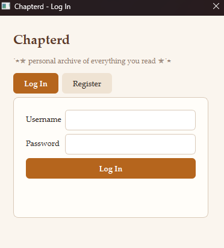
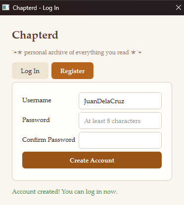
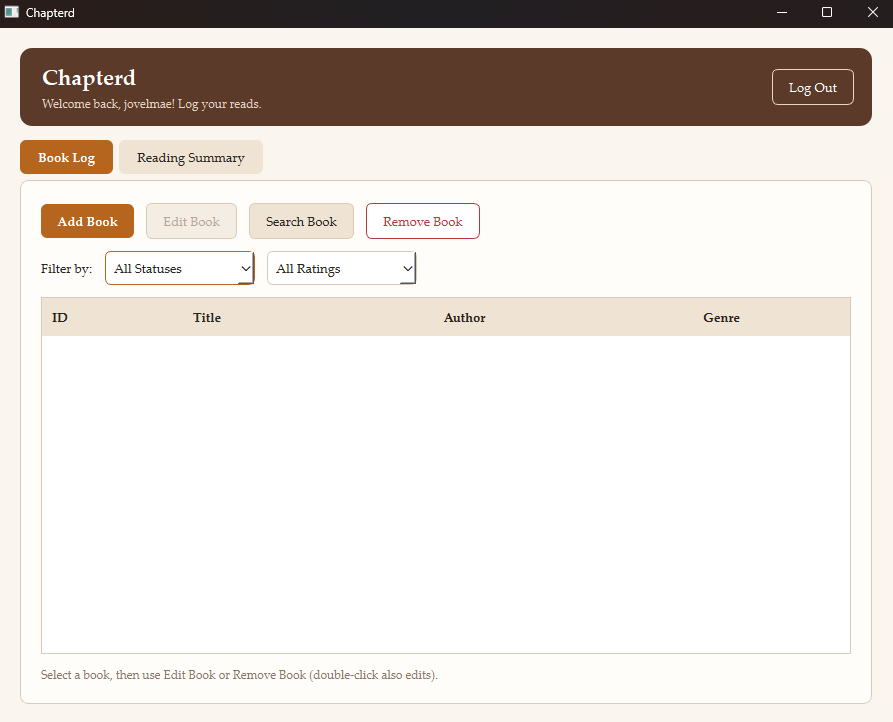
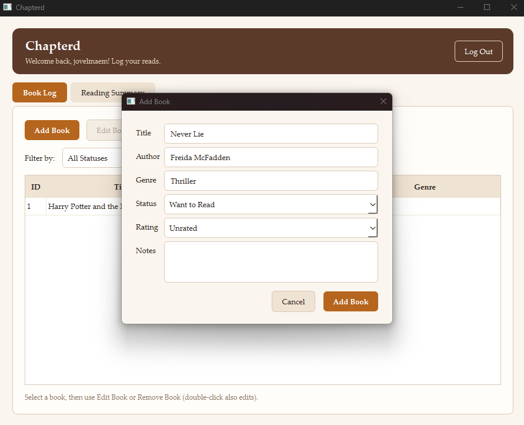
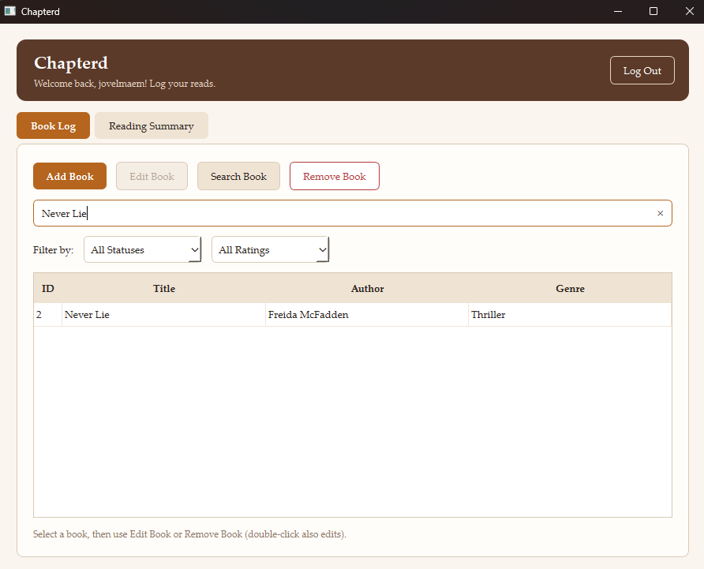
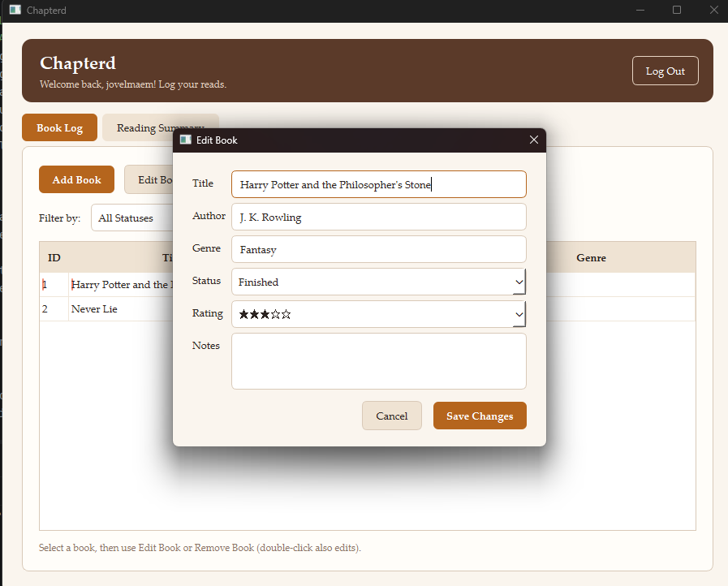
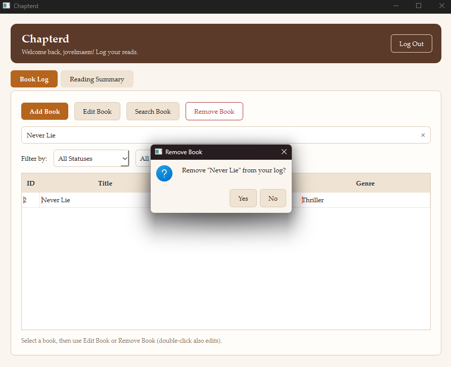
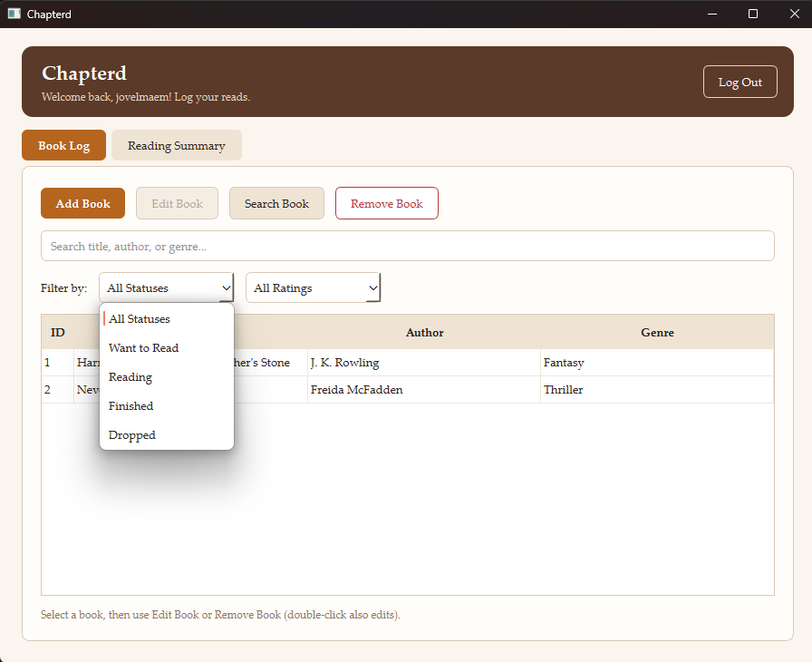
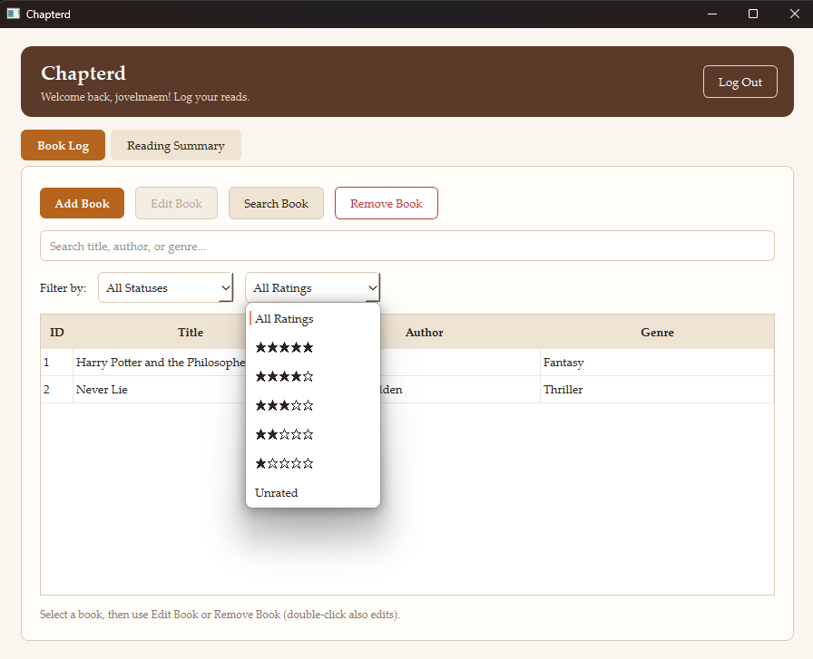
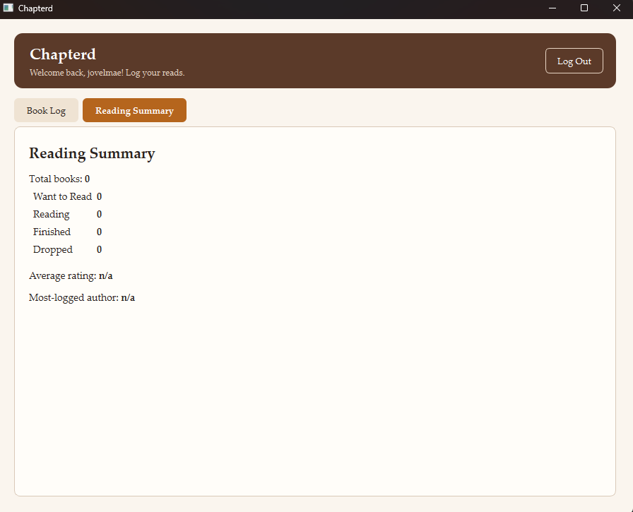

# Chapterd

The system is a desktop-based book log application developed using Python and PyQt6. It allows users to create an account and manage their personal reading records. Users can add books they have read, search for specific books, update book information, remove records, and view a summary of their reading activity.

The system addresses the need for a simple and organized way to keep track of books. Instead of relying on handwritten notes or scattered files, users can store their reading information in one application and easily access, update, and review their book records. It also provides reading statistics to help users see and understand their reading progress.

When you type a title, the app suggests matching books from [Open Library](https://openlibrary.org) and fills in the author and genre for you. This needs an internet connection; everything else works offline.

## Project Objectives

The main objectives of the project are to:
- Organize books based on their reading status: Read, Currently Reading, Want to Read, and Dropped.
- Track and monitor the user’s reading progress.
- Maintain a personal record of books read and collected.
- Provide a simple and convenient way to manage a personal reading archive.
- Allow users to add, search, edit, and remove book records easily from a single Book Log screen.
- Provide reading summaries and statistics to help users review their reading activity.

## Features

The major functions of the system include:
* **User Account Management** – Allows users to create an account (with a Confirm Password field) and log in to access their personal book records. After registering, a green confirmation message is shown; errors are shown in red.
* **Two-Screen Interface** – The app has only two tabs: Book Log and Reading Summary.
* **Add Book** – A button in the Book Log opens a form where users enter the title, author, genre, reading status, rating, and notes.
* **Edit Book** – Select a book and click the Edit Book button (or double-click the book) to update its information.
* **Search Book** – A button in the Book Log shows a search box to quickly find a book by title, author, or genre.
* **Remove Book** – Select a book and click the Remove Book button to delete it from the book log (after confirming).
* **Status and Rating Filters** – Two dropdowns in the Book Log filter the list by reading status (All Statuses, Want to Read, Reading, Finished, Dropped) and by rating (All Ratings, 5 stars down to 1 star, or Unrated). Filters work together with the search box.
* **Per-Account Book IDs** – Every account has its own book IDs that start at 1. A book's ID is never shared with, or shifted by, another account's books.
* **Reading Progress Tracking** – Helps users monitor their reading activity and progress.
* **Reading Summary and Statistics** – Displays the total number of books, the number of books per status, the average rating, and the most-logged author.
* **Personal Book Archive** – Keeps the user’s book records organized in one place for easy access and management.

## Technologies Used

* Programming Language

Python 3.10 or newer – Used as the main programming language for developing the system.
* GUI Framework/Library

PyQt6 – Used to create the desktop graphical user interface (GUI) of the application.
* Database

SQLite – Used to store and manage user accounts, book records, reading statuses, and other system data.
* Other Important Libraries or Tools Used

API – Open Library is used to retrieve book-related information and help reduce the need for users to manually enter book details

Python Standard Libraries – Used for additional functions such as data processing, file handling, and security.


## Project Structure

The first run creates `chapterd.db` in the same folder. That file holds your accounts and books. It is local only and ignored by Git.

```
Chapterd-main/
├── README.md                          project documentation
├── .gitignore                         files Git should ignore (database, cache, venv)
├── screenshots/                       images used in this README
│   ├── AddBook1.png
│   ├── Dashboard.png
│   ├── EditBook1.png
│   ├── LogIn1.png
│   ├── Ratings.png
│   ├── Register1.png
│   ├── RemoveBook1.png
│   ├── SearchBook1.png
│   ├── Status.png
│   └── Summary1.png
└── chapterd_qt/                       the application
    ├── __init__.py
    ├── main.py                        app entry point and main window (ChapterdWindow)
    ├── style.qss                      app colors and styling
    ├── requirements.txt               Python packages needed
    ├── chapterd.db                    created on first run (accounts and books, ignored by Git)
    ├── database/
    │   ├── __init__.py
    │   └── database.py                all SQLite access (accounts, books, per-account book IDs)
    └── features/
        ├── __init__.py
        ├── authentication/            login and register
        │   ├── __init__.py
        │   ├── service.py             account rules and login logic (AuthenticationService)
        │   └── view.py                login/register screen (AuthenticationView)
        └── books/                     book log and reading summary
            ├── __init__.py
            ├── service.py             book rules, statuses and statistics (BookService)
            ├── view.py                Book Log + Reading Summary tabs, add/edit pop-up (BookView, BookDialog)
            ├── widgets.py             book table, book form, status dropdown, title suggestions
            └── lookup.py              Open Library search for title suggestions
```

## Installation and Setup

Before running the system, make sure the following are installed:

- Python 3.10 or newer
- PyQt6
- SQLite3
- Internet connection for the book API
- A code editor or IDE, such as Visual Studio Code / PyCharm

**Step-by-Step Installation**

1. Install Python
- Download and install Python 3.10 or newer.
- Make sure Python is added to the system PATH during installation.
- Verify the installation by opening a terminal and running:
_python --version_
2. Open the Project
- Open the chapterd_qt project folder using PyCharm or another code editor.

3. Create a Virtual Environment

    _python -m venv venv_


4. Activate the Virtual Environment

- For Windows:
_venv\Scripts\activate_

5. Install PyQt6

- _pip install PyQt6_

6. Install Other Dependencies

- Install the required libraries listed in the requirements.txt file:
_pip install -r requirements.txt_

7. Set Up the Database

- SQLite is used as the database and does not require a separate database server.
The application will use the existing database file or create the required database tables when the system is first run.

8. Run the Application

- In the project folder, run:
_python main.py_

9. Log In or Create an Account
- Create a new account if you are a new user.
- Log in to access the Book Log and Reading Summary.

#### Required Dependencies

The main dependencies used by the project include:

* Python 3.10+
* PyQt6 – for the graphical user interface
* SQLite3 – for database management
* Requests or another API library – for connecting to the book API
* Python Standard Library – for built-in functions such as hashing, file handling, and database operations

## How to Use the System

The basic steps for using the Chapterd application are:

1. Open the Application
- Run main.py to launch the Chapterd desktop application.
2. Create an Account
- If you are a new user, select the registration option.
- Enter a username, a password, and the same password again in Confirm Password, then click Create Account.
- A green message confirms the account was created.
3. Log In
- Enter your registered username and password to access the main system.
- The app opens on the Book Log with nothing searched, filtered, or selected.
4. Add a Book
- In the Book Log, click Add Book.
- Type the title (matching books from Open Library are suggested and fill in the author and genre), then set the reading status (Want to Read, Reading, Finished, or Dropped), rating, and notes, and click Add Book.
5. Find Books
- Click Search Book to show the search box and type a title, author, or genre. Click Search Book again to hide and clear it.
- Use the Status and Rating dropdowns to show only books with a certain status or rating.
6. Edit a Book
- Select a book and click Edit Book (or double-click the book), change its details, and click Save Changes.
7. Remove a Book
- Select a book and click Remove Book, then confirm.
8. View Reading Summary
- Open the Reading Summary tab to see your total books, books per status, average rating, and most-logged author.
9. Log Out
- Click Log Out when finished using the application to keep the account secure.

## OOP Implementation

Chapterd uses Object-Oriented Programming (OOP) to organize its features into classes and objects. Each class has a specific responsibility, which keeps the system organized and easier to maintain.

#### Important Classes

* **`ChapterdWindow`** – Manages the main application window, including the header, username, and logout button.
* **`Database`** – Handles the SQLite database, creates the required tables, and gives each account its own book IDs.
* **`AuthenticationService`** – Handles user authentication and logout functions.
* **`AuthenticationView`** – Provides the login and register interface, including the green/red status message.
* **`BookService`** – Manages book-related operations and reading statuses.
* **`BookView`** – Provides the Book Log (Add, Edit, Search, and Remove buttons, plus the Status and Rating filters) and the Reading Summary tabs.
* **`BookDialog`** - The pop-up form used to add a new book or edit an existing one.
* **`BookForm` and `BookTable`** – Reusable widgets for the book details form and the book list.

#### OOP Concepts Used

* **Encapsulation** – Related data and functions are grouped inside their respective classes. For example, `AuthenticationService` handles authentication while `BookService` handles book operations.

* **Inheritance** – `ChapterdWindow` inherits from PyQt6's `QDialog` class:

  ```python
  class ChapterdWindow(QDialog):
  ```

This allows it to use the features of `QDialog` while adding functionality specific to Chapterd. `BookDialog` and `BookTable` likewise extend `QDialog` and `QTableWidget`

* **Objects** – The system creates objects from its classes, such as `Database()`, `AuthenticationService()`, `BookService()`, and `ChapterdWindow()`. These objects work together to run the application.

* **Composition** – Classes work together by receiving and using other objects. For example, `AuthenticationService` and `BookService` use the `Database` object to access stored information, and `BookView` uses `BookTable` and `BookDialog`.

Overall, OOP allows Chapterd to separate its database, authentication, book management, and interface functions into organized and reusable components.

## Database

Chapterd uses **SQLite** as its database. The database stores user accounts and book records, allowing information to be saved and accessed whenever the user opens the application.

#### Database Structure

The database is organized into tables that store different types of information. The important tables include:

* **`users`** – Stores user account information such as the user ID, username, and password.
* **`books`** – Stores the user's book records, including the account it belongs to, its book number `(book_no)`, title, author, genre, reading status, rating, and notes.

The tables are connected using user identifiers so that each user's book records are associated with their own account.

Book IDs per account: the `id` column is the internal key SQLite needs and is shared by all accounts. The ID shown in the Book Log is `book_no`, which is counted separately for each account, so every account's first book is 1, the next is 2, and so on. A book keeps its number when other books are removed, and a new book gets the account's next number. A unique index on `(user_id, book_no)` prevents duplicates within an account.

#### Database Operations

Chapterd performs the following major database operations:

* **Create** – Adds new user accounts and new book records to the database.
* **Read** – Retrieves saved user and book information so it can be displayed in the application.
* **Update** – Allows users to edit book information, such as the reading status, rating, or reading dates.
* **Delete** – Removes book records that the user no longer wants to keep.
* **Search** – Searches the database for specific books based on the title, author, or genre. The Status and Rating filters then narrow these results.

These operations allow Chapterd to efficiently store, manage, and retrieve the user's personal reading records.

## Screenshots

The following screenshots show the important parts and main functions of the Chapterd application.

✮ The login screen allows registered users to enter their username and password to access their Chapterd account.



✮ The registration screen allows new users to create an account by entering a username, a password, and Confirm Password. A green message confirms that the account was created.



✮ The main dashboard is the Book Log. It shows the user's books with the Add Book, Edit Book, Search Book, and Remove Book buttons and the Status and Rating filter dropdowns.



✮ The Add Book button opens a form where users add a book and enter important information such as the title, author, genre, reading status, rating, and notes.



✮ The Search Book button shows a search box that lets users find specific books quickly using the book title, author, or genre.



✮ The Edit Book button (or double-clicking a book) opens the book's details so users can update an existing record.



✮ The Remove Book button deletes the selected book from the collection after the user confirms.



✮ The Status and Rating dropdowns filter the Book Log, and the Reading Summary tab displays an overview of the user's reading activity.




## Testing

The Chapterd application was tested to make sure that its main features work correctly and produce the expected results. Different test cases were performed for account management, book management, searching, filtering, database operations, and reading statistics.

## Testing Results

| Test Case | Expected Result | Actual Result | Status |
|---|---|---|---|
| User Registration | A new user account should be created when valid information is entered. | The account was successfully created and saved in the database. | Passed |
| Registration Message | A green "Account created!" message should appear after registering; errors should appear in red. | The success message was green, and the error messages were red. | Passed |
| Confirm Password | The registration form should have a Confirm Password field, and mismatched passwords should be rejected. | The field was labeled Confirm Password, and mismatched passwords showed an error. | Passed |
| User Login | The user should be able to log in using valid account information. | The user was successfully logged in and directed to the main application. | Passed |
| Two-Tab Interface | Only the Book Log and Reading Summary tabs should be shown. | Only the Book Log and Reading Summary tabs were shown. | Passed |
| Add Book | Clicking Add Book should open a form, and a new book should be added to the user's collection. | The book was successfully added and displayed in the book list. | Passed |
| Edit Book | Clicking Edit Book on a selected book should save the changes and show them in the log. | The updated information was successfully saved and displayed. | Passed |
| Search Book | Clicking Search Book should show a search box that displays books matching the input. | The correct matching books were displayed, and hiding the search box restored the full list. | Passed |
| Remove Book | The selected book should be removed from the collection. | The selected book was successfully removed from the database and book list. | Passed |
| Status and Rating Filters | Choosing a status or rating in the dropdowns should show only the matching books. | Only books with the chosen status or rating were displayed. | Passed |
| Per-Account Book IDs | Each account's book IDs should start at 1 and not depend on other accounts' books. | Every account's first book was ID 1, even when other accounts already had books. | Passed |
| Clean Start | The Book Log should open with no search, filters set to "All," and no book selected. | The log opened with no search or filters applied, and Edit/Remove buttons were disabled. | Passed |
| Reading Status | The user should be able to set a book as Want to Read, Reading, Finished, or Dropped. | The selected reading status was successfully saved and used by the filter. | Passed |
| Reading Summary | The system should display an accurate summary of the user's reading activity. | The reading summary was displayed based on the user's saved book records. | Passed |
| API Book Search | The system should retrieve available book information from the API. | Book information was successfully retrieved and displayed. | Passed |
| Database Storage | User and book information should remain saved after closing and reopening the application. | The saved information was successfully retrieved from the SQLite database. | Passed |
| Database Upgrade | A database from an older version should keep its books and receive per-account book IDs. | Existing books were kept and numbered from 1 for each account. | Passed |

**Testing Result**

Based on the tests performed, the major functions of Chapterd worked as expected. The system was able to manage user accounts, store and manage book records, search and filter books, retrieve information through the API, and display reading summaries. The successful test results indicate that the main features of the application are functioning properly.

## Run the app

```
cd chapterd_qt
python -m pip install -r requirements.txt
python main.py
```
## Known Issues / Limitations

* **API Dependency** – Book information requires an internet connection and an available API.
* **Incomplete Book Data** – Some books may have missing information from the API.
* **Desktop Only** – Chapterd is currently available only as a desktop application.
* **Local Database** – Data is stored locally and cannot be automatically synced across devices.
* **Basic Account Features** – Password recovery and email verification are not yet implemented.
* **Filters Hide Status and Rating** - The Book Log table does not show Status and Rating columns; use the filter dropdowns, or the Edit Book form, to see them.

## Author 

- Jovel Mae U. Mejala
- CS26L - 3581 (BSCS - 2)